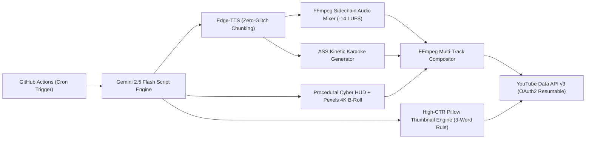

# The Machine Economy // Autonomous YouTube Channel Architecture

An enterprise-grade, zero-cost, fully autonomous YouTube content production pipeline built for the 2026/2027 YouTube algorithm. Produces high-retention, monetization-proof faceless videos in the **"Machine Economy & Speculative Tech"** niche ($25–$45+ CPM).

---

## Architecture Overview



---

## Key Features

1. **Zero-Glitch Voice Engineering:**
   * Text normalization translates abbreviations (`A-G-I`, `G-P-U`), currency (`$40 trillion dollars`), and years.
   * Semantic sentence-boundary chunking prevents buffer overflows, dropped sentences, and abrupt audio clipping.
2. **Dynamic Sound Design:**
   * FFmpeg sidechain compression ducks background ambient synthesizer by 18dB during speech and swells during pauses.
   * Master audio is normalized to YouTube's exact **-14 LUFS** standard.
3. **Monetization-Proof Multi-Track Visuals:**
   * Eliminates the "reused content" trap with 4-track layering:
     1. 4K high-res b-roll / procedural cyber-grid motion.
     2. Dynamic animated HUD metric cards (e.g. `$40 TRILLION`).
     3. Kinetic glowing typography (`.ass` styling).
     4. Subtle film grain and cinematic color grade.
4. **YouTube Algorithm Optimization:**
   * 0:00–0:05 Paradox Hook: captures immediate cognitive dissonance.
   * High-CTR thumbnail styling: 3-word rule, intense obsidian-cyan-gold contrast.
   * Automated timestamp chapters and semantic keyword clustering.

---

## Local Usage

### 1. Installation
```bash
pip install -r requirements.txt
```

### 2. Generate a Test Short (Dry Run)
```bash
python pipeline.py --type short
```

### 3. Generate a Long-form Documentary (Dry Run)
```bash
python pipeline.py --type long
```

### 4. Publish Live to YouTube
```bash
python pipeline.py --type short --live --privacy public
```

---

## GitHub Actions Automated Deployment

Add these encrypted secrets in your repository settings (`Settings > Secrets and variables > Actions`):

| Secret Name | Source / Purpose |
| :--- | :--- |
| `GEMINI_API_KEY` | Google AI Studio API key |
| `PEXELS_API_KEY` | (Optional) Pexels API key for royalty-free stock footage |
| `YT_CLIENT_ID` | Google Cloud Console OAuth 2.0 Client ID |
| `YT_CLIENT_SECRET` | Google Cloud Console OAuth 2.0 Client Secret |
| `YT_REFRESH_TOKEN` | OAuth 2.0 Refresh Token for YouTube channel |

The channel publishes on a scheduled cron:
* **Shorts:** Tuesday, Thursday, Saturday at 14:00 UTC
* **Long-Form:** Sunday at 16:00 UTC

